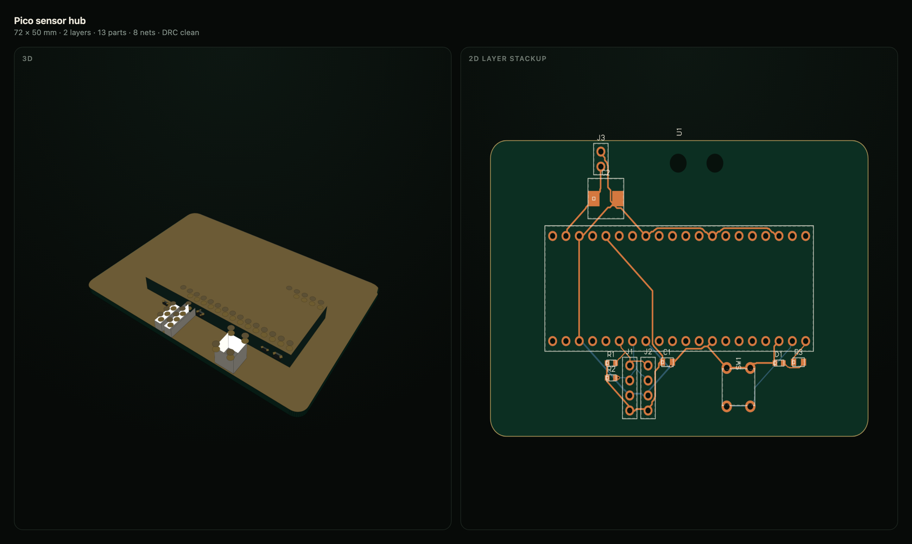

# Circuit — design real PCBs by talking to your agent

**Describe a board in chat. Get a routed, checked, fabrication-ready PCB back — with Gerbers, a KiCad project, a STEP model, and a 3D view you can spin.**

Circuit is a Hermes plugin that turns a conversation into hardware. It is a complete
2-layer PCB compiler: a curated part library, a deterministic placer, an autorouter,
an independent design-rule checker, and a fabrication exporter — all in plain Python
with **zero third-party runtime dependencies**, running entirely on your machine.

No KiCad install. No EDA licence. No cloud account. No upload of your design to
someone else's server.

```
You:  build me a Pico sensor hub with a BME280 and an OLED header, powered from 5 V

Hermes: → circuit_create(template="pico-sensor-hub")
        → circuit_route()      → circuit_check()      → circuit_export()

        72 × 50 mm · 2 layers · 13 parts · 8 nets · DRC clean
        Gerbers, drills, KiCad project, STEP, shopping list, poster — 28 files
        ::circuit{board="pico-sensor-hub"}
```



---

## Table of contents

- [Why this exists](#why-this-exists)
- [The 60-second demo](#the-60-second-demo)
- [Install](#install)
- [Your first board](#your-first-board)
- [What you get: the fabrication package](#what-you-get-the-fabrication-package)
- [The 15 tools](#the-15-tools)
- [Three documents, one line of chat](#three-documents-one-line-of-chat)
- [Feature tour](#feature-tour)
  - [A part library with pin numbers that mean something](#a-part-library-with-pin-numbers-that-mean-something)
  - [Placement and routing that are deterministic](#placement-and-routing-that-are-deterministic)
  - [A DRC that certifies the copper, not the intent](#a-drc-that-certifies-the-copper-not-the-intent)
  - [Exports a fabricator and an assembly house both accept](#exports-a-fabricator-and-an-assembly-house-both-accept)
  - [Reproducible builds](#reproducible-builds)
  - [Import any KiCad board and look at it properly](#import-any-kicad-board-and-look-at-it-properly)
  - [A 3D viewer that is a real renderer](#a-3d-viewer-that-is-a-real-renderer)
- [Recipes](#recipes)
- [Configuration](#configuration)
- [How it is built](#how-it-is-built)
- [Testing](#testing)
- [Contributing](#contributing)
- [FAQ](#faq)
- [License](#license)

---

## Why this exists

EDA tools are built for humans drawing with a mouse. Agents are not that. Circuit
is built for the shape an agent actually has: a text interface, a deterministic
tool loop, and the ability to iterate a hundred times without getting bored.

That leads to a different architecture from a normal CAD tool:

- **The netlist is the source of truth.** Not a schematic file, not a binary
  document — a plain dict of `{net: [(ref, pin), …]}`. Everything else (placement,
  routing, Gerbers, the viewer, the STEP model) is derived from it. Re-derive any
  time and you get the same answer.
- **Every step is a tool call with a JSON result.** `circuit_route()` returns the
  nets it failed and why. `circuit_check()` returns a verdict. `circuit_export()`
  returns 28 files with sizes. An agent can read that, fix it, and try again.
- **Nothing is hidden behind a GUI.** There is no state that lives only in a
  window. If you can describe it, you can script it, diff it, or regenerate it.
- **It runs locally and offline.** Your design never leaves the machine, and a
  board built today rebuilds byte-identically tomorrow.

The result is a loop that feels like pair-designing with someone who never gets
tired: *describe → place → route → check → look at it → change one thing → repeat.*

## The 60-second demo

A real session, start to finish:

```
> circuit_create(title="Weather node", template="pico-blinky")
  created weather-node · routed 6/6 nets · DRC clean

> circuit_add_part(part="bme280-brk", nets={"1":"+3V3","2":"GND"})
  added U2 (bme280-brk) at the next free slot

> circuit_connect(connections=[["U2","SDA","U1","GP4"],
                              ["U2","SCL","U1","GP5"],
                              ["U2","VIN","U1","3V3"],
                              ["U2","GND","U1","3"]])
  joined 4 connections

> circuit_place()
  placed 10 components · 68 × 44 mm · no courtyard overlaps

> circuit_route(effort="normal")
  routed 9/9 nets · 3 vias · DRC clean

> circuit_check()
  ok · ERC clean · DRC clean

> circuit_export()
  ok · 28 files · gerbers, drills, kicad, step, bom, pos, manifest, documents
```

That is the real output of that sequence, not a mock-up. Pin **names** work
(`"SDA"`, `"VIN"`) as well as pad numbers; where a name is ambiguous — a module
with eight `GND` pads — the tool tells you which pad numbers to pick.

Then the agent emits one line and the board appears in the chat:

```
::circuit{board="pico-sensor-hub"}
```

Drag to orbit the 3D model. Scroll to zoom. Toggle copper, mask, silkscreen,
drills, parts and explode from the layer chips. Switch to 2D for the flat layer
stackup, or open the **Nets**, **BOM**, **DRC** and **Files** tabs.

## Install

Circuit is a standard Hermes plugin. Requirements: Hermes ≥ 0.21.5, Python 3.11+.

```bash
git clone https://github.com/odtboun/hermes-circuit
ln -s "$PWD/hermes-circuit/circuit" "$HERMES_HOME/plugins/circuit"
hermes plugins enable circuit
```

Restart the desktop app (or the gateway) once so the Python backend mounts, then
open **Settings → Plugins → Circuit** and switch the desktop half on.

The plugin then shows up in three places:

- **Sidebar → Circuit** — the full workspace: board list, 2D/3D viewer, tabs.
- **⌘K → Circuit** — jump straight to it from the command palette.
- **Inline in chat** — whenever the agent emits `::circuit{board="…"}`.

Verify the install:

```bash
hermes plugins validate ./circuit     # manifest, schema, tool signatures
hermes plugins doctor ./circuit --ci  # loads the module and calls every tool
```

## Your first board

Three ways in, depending on how much you want to think.

**1. Start from a template** (fastest — real netlists, already routed):

```
circuit_create(title="My blinky", template="pico-blinky")
circuit_export()
circuit_view()
```

| template | what it is |
|---|---|
| `pico-blinky` | Raspberry Pi Pico carrier with an LED and a resistor — the smallest useful board |
| `pico-sensor-hub` | Pico + BME280 over I²C + OLED header — a real sensor node |
| `nano-relay` | Arduino Nano + ULN2003 + two relays + screw terminals — 88 × 62 mm |
| `pico-relay-4` | Four-channel relay controller: Pico, ULN2003, protected 5 V input, four screw terminals, status LEDs, test points — 39 parts, hand-placed, 90 × 116 mm |
| `power-5v` | 5 V regulator with bulk and decoupling — the front end of everything else |

**2. Build it part by part** (the agent's normal path):

```
circuit_catalog(query="ne555")                 # find the part, see its pin names
circuit_create(title="Timer", width=40, height=30)
circuit_add_part(part="ne555", nets={"1": "GND", "4": "+5V", "8": "+5V"})
circuit_add_part(part="r-0805", value="10k", nets={"1": "+5V", "2": "DIS"})
circuit_connect(connections=[["U1", "OUT", "R1", "1"], ["R1", "2", "C1", "1"]])
circuit_place()
circuit_route()
circuit_check()
circuit_export()
```

**3. Start from a board you already have** — see [importing](#import-any-kicad-board-and-look-at-it-properly).

## What you get: the fabrication package

One `circuit_export()` writes **28 files** into
`<HERMES_HOME>/plugin-data/circuit/projects/<slug>/exports/`:

| group | files | what it is for |
|---|---|---|
| **Fab** | `F_Cu`, `B_Cu`, `F_Mask`, `B_Mask`, `F_Silkscreen`, `B_Silkscreen`, `Edge_Cuts` `.gbr` | RS-274X Gerbers, 4.6 metric, with X2 file-function attributes |
| | `F_Paste.gbr` | stencil apertures for the SMT side |
| | `PTH.drl`, `NPTH.drl` | Excellon, metric, plated and non-plated split |
| | `<slug>.gbrjob` | Ucamco job file: every file mapped to its layer role, plus stackup |
| | `readme.txt` | the stackup, the rules and the DRC verdict, inside the zip |
| | `<slug>-gerbers.zip` | all of the above, upload-ready |
| **CAD** | `kicad/<slug>.kicad_pcb`, `.kicad_pro` | opens in the KiCad 8 PCB editor with real footprints, nets, tracks, vias |
| **Mechanical** | `<slug>.step` | AP214 B-rep of the substrate and every component body, for enclosures |
| **Assembly** | `bom.csv` | refs, qty, value, part, footprint, description, **MPN**, **Mfr** |
| | `pos.csv` | generic pick-and-place: ref, part, footprint, x, y, rot, side |
| | `pos-jlcpcb.csv` | assembly dialect: mm, `Mid X`/`Mid Y`, `Top`/`Bottom`, rotation |
| | `<slug>-assembly.zip` | BOM + both PnP files + stencil + readme, one hand-off |
| **Data** | `netlist.json`, `board.json` | the design itself, readable and diffable |
| | `manifest.json` | SHA-256 for every artefact, the rules, the DRC report |
| **Human** | `preview.svg`, `preview.html` | standalone, offline, no scripts beyond one inline renderer |
| | `bom.html` | the shopping list: every part with four distributor search links |
| | `wiring.html` | the wiring card: pin → net → destination, one table per connector |
| | `poster.html` | the one-page board poster: render, stats, top of the BOM |

Everything a fabricator needs to *quote and build* is inside the two zips.
Everything a human needs to *review* is a file you can open.

## The 15 tools

The whole design loop is exposed as tools, so an agent can drive it and you can
drive it by hand.

| tool | what it does | key arguments |
|---|---|---|
| `circuit_catalog` | search the part library | `query`, `category` |
| `circuit_create` | new board, optionally from a template | `title`, `width`, `height`, `template` |
| `circuit_boards` | list projects with size, parts, DRC state | — |
| `circuit_board` | one board in full: components, pins → nets, nets, DRC, stats | `board` |
| `circuit_add_part` | add a part and its net assignment | `part`, `nets`, `ref`, `value` |
| `circuit_connect` | join pins across parts | `connections` |
| `circuit_remove_part` | delete a part and its pins from their nets | `ref` |
| `circuit_place` | deterministic auto-placement, or explicit positions | `positions`, `fit` |
| `circuit_route` | autoroute every net, then run DRC | `effort` |
| `circuit_check` | ERC + DRC verdict with reasons | — |
| `circuit_export` | write the whole fabrication package | `route` |
| `circuit_view` | render the board inline in chat | `inline` |
| `circuit_docs` | generate the shopping list, wiring card or poster | `kind` |
| `circuit_import` | import a `.kicad_pcb` from a path or URL | `path`, `url` |
| `circuit_samples` | load real open-source KiCad boards on demand | `action`, `id` |

## Three documents, one line of chat

Every board already knows what it is made of, what every pin is for and what it
looks like. Circuit turns that into documents you can use away from the editor:

| document | what it is | who it is for |
|---|---|---|
| **Shopping list** (`bom.html`) | one row per BOM line — qty, value, refs, footprint, description, MPN — and four buy links per row: Digi-Key, Mouser, LCSC, Octopart | you, with a browser and a card |
| **Wiring card** (`wiring.html`) | a table per connector: pin, pin name, net with its class colour, and every other pin on that net (`U1.36`, `R2.1`, …) | the person with a soldering iron and a cable |
| **Board poster** (`poster.html`) | the board render as the hero, the size/layer/finish line, the DRC verdict, a stats grid and the top of the BOM | a README, a tweet, a slide, a wall |

Ask for one and it appears in the chat, the same way the board does:

```
> circuit_docs(board="pico-sensor-hub", kind="poster")

::preview{file="…/exports/poster.html"}
```

…and the same three documents are a **Docs** tab in the plugin page, rendered in
place, no download and no second window.

The buy links are built locally from the MPN — `digikey.com/en/products/result?keywords=BME280`
and the same shape for the other three — so the page never calls a distributor,
never needs an API key, and never fails on camera. When an MPN is not known yet the
link falls back to value + footprint, and the MPN column says so instead of
inventing a part number. Filling those in is the agent's job: it can look a part up
and write the MPN back into the board, and the next export carries it.

The pages are standalone: inline CSS, inline SVG, no scripts, no fonts to fetch, no
images to load. They open in the preview pane, print on paper, and travel inside
`<slug>-assembly.zip` — a contract manufacturer wants the shopping list and the
wiring table more than the Gerbers. The layout holds from a 420 px preview up to a
full-page print.

A bundled skill (`circuit-design`) teaches the agent the workflow and the
conventions — pin **numbers** as net keys, the order of operations, and how to read
a failed route.

## Feature tour

### A part library with pin numbers that mean something

62 curated parts across 14 categories — passives, diodes, transistors, ICs,
optoelectronics, sensors, timing, power, relays, switches, connectors, modules,
audio and mechanical — over 44 hand-checked footprints.

Each part carries its **pin names in datasheet order**, so you connect
`{"1": "GND", "2": "TRIG", "3": "OUT"}` rather than guessing which side is which —
and `circuit_connect` accepts the name or the pad number (`"SDA"` or `"4"`), telling
you which pads to use when a name like `GND` appears eight times.
The footprint knows its own body size, pad geometry and courtyard, which means
placement reasons about real physical space instead of a bounding box.

Adding a part is a two-line change (see [contributing](#adding-a-part)).

### Placement and routing that are deterministic

`circuit_place()` has no randomness. Same netlist in, same layout out — every time,
on every machine. That is what makes an agent loop possible: change one thing,
rebuild, and diff the result.

The router is a two-tier grid maze router: it searches the real geometry of the
pads and existing copper on a 0.1 mm grid, prefers the cheapest path, and reports
exactly which nets it could not complete. Power and ground get wider traces
automatically from net-class heuristics. `effort: fast` probes fewer pads per net
for quick iteration; `effort: normal` searches all of them.

### A DRC that certifies the copper, not the intent

Most routers claim success and leave the checking to you. Circuit's DRC works on
the **final geometry** — every pad outline, every routed segment, every via — so it
catches anything the router mis-modelled rather than trusting it.

It checks:

- copper-to-copper clearance between foreign nets, with real polygon distance
- minimum trace width, minimum drill, annular ring
- board-edge clearance
- **full net connectivity** — a net that is only partly routed is an error, not a warning
- silkscreen printing on a mask opening (the thing fabs silently clip)

ERC runs alongside it: dangling nets, missing power or ground, courtyard overlaps.

The verdict is a plain dict — `ok`, `errors`, `warnings`, `counts`, `unrouted_nets`
— which is why the agent can act on it instead of just reporting it.

### Exports a fabricator and an assembly house both accept

Beyond the Gerbers: a `<slug>.gbrjob` so the fab does not have to guess which file
is which layer, a `readme.txt` inside the zip with the stackup and rules, a stencil
layer, and a separate assembly package with the BOM, both pick-and-place dialects
and the stencil. Vias are tented by default — the way real boards are made — with
`tent_vias: false` in the board rules when you want them open.

Silkscreen is **clipped against mask openings** before it reaches the Gerber, so
what you see in the viewer is what the fab will actually print, not what you drew.

### Reproducible builds

Set `SOURCE_DATE_EPOCH` and two exports of the same board are byte-identical — STEP
header, readme, job file, manifest, zip entry timestamps and `board.json` included.
That turns `manifest.json` into a real fingerprint of a design rather than a note
that a file was written recently.

```bash
SOURCE_DATE_EPOCH=1700000000   # in the environment Hermes runs in, then circuit_export()
```

### Import any KiCad board and look at it properly

`circuit_import` takes a `.kicad_pcb` by path **or URL** (KiCad 6/7/8 and newer)
and turns it into a project you can open, orbit, inspect and screenshot: outline,
every footprint, every pad with its net, tracks, vias, silkscreen and drills.

```
circuit_import(url="https://raw.githubusercontent.com/olimex/ESP32-POE-ISO/HEAD/HARDWARE/ESP32-PoE-ISO-Rev.D/ESP32-PoE-ISO_Rev_D.kicad_pcb")
circuit_view()
```

Imported boards open **read-only**, which is a feature: you can explore a design you
found online — or your own legacy board — without any risk of the agent accidentally
changing it. Re-importing the same path or URL replaces the project rather than
piling up copies.

There is also a curated catalogue of real open-source boards to load in one call:

```
circuit_samples(action="list")
circuit_samples(action="load", id="tiny-tapeout")   # 309 footprints, 104 × 81 mm
```

Fifteen boards, 1 to 309 parts:

| id | parts | board | why load it |
|---|---|---|---|
| `nfc-antenna` | 1 | 23 × 58 mm | the whole board is one spiral of copper |
| `ecc83` | 15 | 52 × 46 mm | valve preamp: big through-hole pads and silk lettering |
| `interf-u` | 24 | 116 × 108 mm | ISA card, long parallel buses, 84 vias |
| `sonde-xilinx` | 25 | 80 × 43 mm | probe card with a dense header row |
| `pic-programmer` | 63 | 160 × 99 mm | the classic through-hole demo |
| `complex-hierarchy` | 68 | 101 × 80 mm | 68 parts and **zero vias** — the cleanest board |
| `royalblue54l-feather` | 71 | 58 × 23 mm | feather module, 8 layers flattened |
| `stickhub` | 94 | 16 × 40 mm | a USB stick: the small-board test |
| `cm5-minima` | 112 | 61 × 64 mm | compact 6-layer carrier |
| `multichannel` | 114 | 110 × 111 mm | routed 6-channel mixer |
| `multichannel-unrouted` | 114 | 110 × 111 mm | the same board *before* routing |
| `coldfire` | 160 | 158 × 91 mm | 160 parts, 825 pads, 253 vias |
| `video` | 189 | 312 × 107 mm | a PCI-era board as wide as your monitor |
| `openair-max` | 210 | 99 × 72 mm | mixed SMD/THT control board, 410 vias |
| `tiny-tapeout` | 309 | 104 × 81 mm | the densest: 309 footprints, 1481 traces |

### A 3D viewer that is a real renderer

The desktop half is one SDK-only ES module with a hand-written canvas renderer,
because the plugin sandbox allows only `@hermes/plugin-sdk` and `react` — which is
also why it works offline and starts instantly.

It is not a stack of sprites. The 3D view:

- resolves depth **per pixel** with a software z-buffer, so nothing pops, nothing
  shows through, and overlapping parts can never interleave
- builds **procedural package geometry** from the footprint name: 48 package
  families with real body heights (0402 = 0.5 mm, SOIC-8 = 1.6 mm, QFN = 0.9 mm,
  TO-220 = 9 mm …), chamfered or cylindrical bodies where the real part is round,
  gull-wing leads that span from the body edge to the pad end, side pads on QFN,
  castellated edges on modules, holes in sockets, lens discs on LEDs
- rasterises the silkscreen into a **board-space texture** sampled at display
  resolution, so designators and pin labels are legible instead of a field of
  white sticks
- clips geometry at the near plane, so zooming into a corner never deletes the board
- fills concave outlines with even-odd spans, so a notch in the edge stays a notch

A 12,000-face board renders in about 12 ms, and the same renderer draws the inline
chat card and the full workspace page.

## Recipes

**Add a sensor and wire it to an existing bus**

```
circuit_add_part(part="bme280-brk", nets={"1":"+3V3","2":"GND"})
circuit_connect(connections=[["U2","SDA","U1","GP4"], ["U2","SCL","U1","GP5"]])
circuit_place(); circuit_route(); circuit_check()
```

**Make a board with a specific size**

```
circuit_create(title="Front panel", width=120, height=45)
```

The outline is a rounded rectangle; placement and routing fit inside it, and DRC
enforces edge clearance.

**Put a part somewhere exact**

```
circuit_place(positions=[{"ref": "U1", "x": 20, "y": 15, "rot": 90}])
```

Listed parts move; everything else stays where it was.

**Iterate on routing effort**

```
circuit_route(effort="fast")     # quick look while the design is still moving
circuit_route(effort="normal")   # final pass, searches every pad
```

**Ship a board to a fabricator**

```
circuit_export()
# → exports/<slug>-gerbers.zip   upload this one to the fab
# → exports/<slug>-assembly.zip  send this one to the assembly house
```

**Compare your board against a real one**

```
circuit_samples(action="load", id="cm5-minima")
circuit_view()
```

**Check what the fab will actually print**

Open the **Files** tab, or `exports/preview.html` — silkscreen is already clipped
the way the fabricator will clip it.

## Configuration

Per-plugin settings live in `plugin.yaml` and are editable from
**Settings → Plugins → Circuit**:

| key | default | what it does |
|---|---|---|
| `trace_width` | `0.2` mm | signal-net trace width for new boards |
| `clearance` | `0.15` mm | copper-to-copper clearance the router and DRC enforce |
| `grid` | `0.1` mm | autorouter grid; 0.1 handles 2.54 mm headers |
| `effort` | `normal` | `fast` probes fewer pads per net, `normal` searches all |
| `default_board_width` | `50` mm | width for a new empty board |
| `default_board_height` | `40` mm | height for a new empty board |

Per-board rules (clearance, via size, minimum drill, edge clearance, tenting) are
stored with the project and show up in the manifest, so an exported board always
documents the rules it was built with.

## How it is built

```
┌──────────────────────────── Hermes agent ────────────────────────────┐
│  14 circuit_* tools          bundled skill "circuit-design"          │
└───────────────┬──────────────────────────────────────────────────────┘
                │
┌───────────────▼─────────────┐        ┌──────────────────────────────┐
│ Design engine (Python)      │        │ Desktop half (SDK-only JS)   │
│  parts + footprints         │        │  ::circuit{board="…"} card   │
│  netlist / ERC              │◀──────▶│  /circuit workspace page     │
│  autoplace + autorouter     │  REST  │  2D layer stackup (canvas)   │
│  DRC + connectivity         │        │  3D z-buffer render (canvas) │
│  Gerber / Excellon / KiCad  │        │  nets, BOM, DRC, files       │
│  STEP / SVG / manifest      │        └──────────────────────────────┘
└─────────────────────────────┘
```

- **Engine** — `circuit/circuit_core/`: geometry, the part library, deterministic
  placement, the maze router, an independent DRC that certifies the final copper,
  and the exporters. Standard library only.
- **Agent surface** — `circuit/tools.py` + `circuit/schemas.py`: the 15 tools and
  their JSON schemas, plus the bundled skill that teaches the workflow.
- **Desktop half** — `circuit/desktop/plugin.js`: one ESM file that registers the
  transcript directive, the workspace page and a sidebar entry, and contains the
  entire 2D/3D renderer.
- **Backend** — `circuit/dashboard/plugin_api.py`: board and file routes under
  `/api/plugins/circuit/`, plus the rebuild endpoint the UI's button uses.

```
circuit/                  the installable plugin
  plugin.yaml             manifest, tools, config schema
  tools.py                the 14 tool handlers
  schemas.py              JSON schemas the agent sees
  circuit_core/
    lib/                  parts.py (62 parts), footprints.py (44 footprints)
    geom.py               geometry primitives
    project.py            the Board model: components, nets, routes, rules
    placement.py          deterministic auto-placement
    router.py             two-tier grid maze router
    drc.py                design-rule check + connectivity
    layers.py             copper / mask / paste / silk / drills / BOM / PnP
    fab/                  gerber.py, kicad.py, step.py, svg.py
    compile.py            build(): place → route → DRC → export → view doc
    import_kicad.py       the KiCad board parser
    samples.py            the open-source board catalogue
    templates.py          the four starter designs
    store.py, view.py     project storage and the render contract
  dashboard/              FastAPI routes mounted at /api/plugins/circuit/
  desktop/plugin.js       the desktop half (single file, SDK-only)
  skills/                 the skill the agent loads
tests/                    pytest suite + the Node harness
docs/                     architecture, design rules, catalog notes
```

Deeper reading: [docs/ARCHITECTURE.md](docs/ARCHITECTURE.md) for the decisions and
why they were made, [docs/DESIGN_RULES.md](docs/DESIGN_RULES.md) for the rule set
and the library format.

## Testing

Two suites, both run in CI on every push and pull request:

```bash
pytest                  # 81 Python tests
node tests/js/run.mjs   # 68 assertions against the desktop plugin
```

The Python suite does not just check that files exist. It **parses them back**:

- Gerbers are read by an independent RS-274X parser in `fab/gerber.py`, and the
  test asserts the round-tripped geometry lands inside the board outline
- every aperture is declared before use; every drill appears in the Excellon tool table
- the KiCad project is re-read and checked for footprints, nets, tracks, vias, Edge.Cuts
- the STEP file is parsed for a valid AP214 header and a closed shell per part
- the manifest's SHA-256 for every file is recomputed from disk
- exports are rebuilt twice under `SOURCE_DATE_EPOCH` and must be byte-identical
- the router is checked for connectivity, not just for "no exceptions"
- the API routes are exercised with a real FastAPI test client

The Node harness runs the desktop plugin against a stubbed SDK: it asserts the
plugin registers its surfaces, that the transcript directive parses, that the 3D
renderer culls and depth-tests correctly, that a concave outline is filled with
even-odd spans, that the board still paints when the camera is inside it, and that
package geometry (heights, silhouettes, lead bands, header posts) matches the
library.

## Contributing

Contributions are welcome — this is a young project with a lot of surface area and
a clear shape, so it is a good place to make a real difference.

```bash
git clone https://github.com/odtboun/hermes-circuit
cd hermes-circuit
python -m venv .venv && source .venv/bin/activate
pip install pytest httpx fastapi
pytest && node tests/js/run.mjs
```

Both suites must pass before a PR. The CI workflow runs exactly those two commands.

### Adding a part

Parts live in `circuit/circuit_core/lib/parts.py` and reference a footprint from
`circuit/circuit_core/lib/footprints.py`. Adding one is two small, declarative
changes:

```python
# footprints.py — real geometry, in millimetres, in the part's own frame
_register(
    "sot-23-6", "SOT-23-6", [
        _pad("1", -0.95, -1.1, 0.6, 1.0),
        _pad("2",  0.0,  -1.1, 0.6, 1.0),
        # …
    ],
    {"w": 2.9, "h": 1.6, "z": 1.1, "color": "ic"},
    {"w": 4.0, "h": 3.4}, tags=["smd", "sot"],
)

# parts.py — the pin map in datasheet order is the valuable part
_part("ap22653", "AP22653 load switch", "sot-23-6", "power",
      "1.5 A current-limited load switch",
      pins={"1": "IN", "2": "GND", "3": "EN", "4": "FLG", "5": "ILIM", "6": "OUT"},
      tags=["load-switch"])
```

Then add a test in `tests/test_library.py` that the pin count, the pad count and the
courtyard agree. The library is checked for self-consistency: pads never overlap,
courtyards enclose pads, and drill and annular-ring rules pass.

### Adding a template

`templates.py` holds four starter designs. A template is a netlist plus a title and
a board size — no geometry, no hand-drawn routing. If it routes and DRCs clean in
one call, it is a good template.

### Adding a tool

1. Write the handler in `circuit/tools.py` (return `ok(...)` or `err(...)`).
2. Register it in `HANDLERS`.
3. Add its schema to `circuit/schemas.py` and to `ALL`.
4. Document it in `circuit/skills/circuit-design/SKILL.md`.
5. Add it to `provides_tools` in `plugin.yaml`.

### Working on the desktop half

`circuit/desktop/plugin.js` is hand-written `jsx()` / `jsxs()` calls — there is no
build step. Two things to know:

- `jsxs(type, props, key)` — the third argument is **`key`**, not children. Children
  go in `props.children`. The harness enforces this with a stub that throws if you
  get it wrong.
- Anything the renderer does must be checkable without a browser. The harness runs
  the real functions against a recording canvas context; add an assertion there
  whenever you fix a rendering bug, so it cannot come back.

### Conventions

- **Commit messages** describe the change and the reasoning, in the imperative:
  `Fab: tent the vias in the soldermask`. Say what was wrong and what the evidence is.
- **Measure, do not assert.** If a fix changes rendering or geometry, put the
  before/after numbers in the commit message. The history is full of them, and they
  are the most useful part of it.
- **No new runtime dependencies** in the engine. Standard library only — that is
  what keeps the plugin installable anywhere and the exports reproducible.
- **Tests with the change**, not after it.

### Good first contributions

- A part you actually use — a sensor, a connector, a regulator — with its datasheet
  pin map.
- A template for a board class you build often: an ESP32 carrier, a CAN node, a
  motor driver.
- A rendering improvement with a before/after measurement.
- A new DRC rule with a test that fails without it.
- Documentation: a worked example, a recipe, a screenshot.

## FAQ

**Where do my boards live?**
`<HERMES_HOME>/plugin-data/circuit/projects/<slug>/` — `board.json` is the design,
`view.json` is what the viewer renders, `exports/` is everything you can hand to
someone else.

**Can I edit the board outside the agent?**
Yes. `board.json` is a plain JSON document (components, nets, routes, rules) and
`netlist.json` is the netlist on its own. Edit, then run any tool to re-derive the
rest.

**Can I open the result in KiCad?**
Yes — `exports/kicad/<slug>.kicad_pcb` opens in the KiCad 8 PCB editor with real
footprints, nets, tracks and vias, so you can finish a design there.

**Can I get a mechanical model for an enclosure?**
`exports/<slug>.step` is an AP214 B-rep of the substrate plus every component body,
sized from the package geometry the viewer uses.

**What if the router cannot finish a net?**
`circuit_route()` returns the nets it failed and the DRC report explains why. Move
the parts (`circuit_place(positions=…)`), widen the board, or lower the clearance —
then route again. The loop is fast on purpose.

**Does anything leave my machine?**
No. The engine is local, the viewer is local, and the only network calls in the
whole plugin are `circuit_samples` and `circuit_import url=`, which you invoke
explicitly to fetch a board.

**How do I make the output reproducible?**
`SOURCE_DATE_EPOCH=<unix time>` in the environment before exporting. Two builds then
produce identical bytes and identical manifest hashes.

**Before you order:** footprint geometry comes from the bundled library and is
checked for self-consistency, and every export ships with its DRC report and a hash
per file — confirm the parts against their datasheets as you would with any design,
then send the zip.

## License

MIT — see [LICENSE](LICENSE).

Built with Hermes Agent by Nous Research. Boards are compiled, not guessed: every
file in an export is derived from the same netlist you can read.
