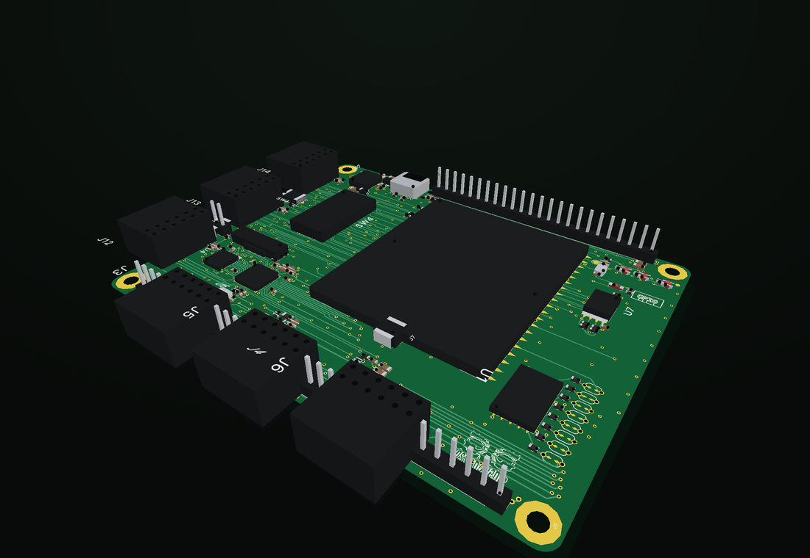
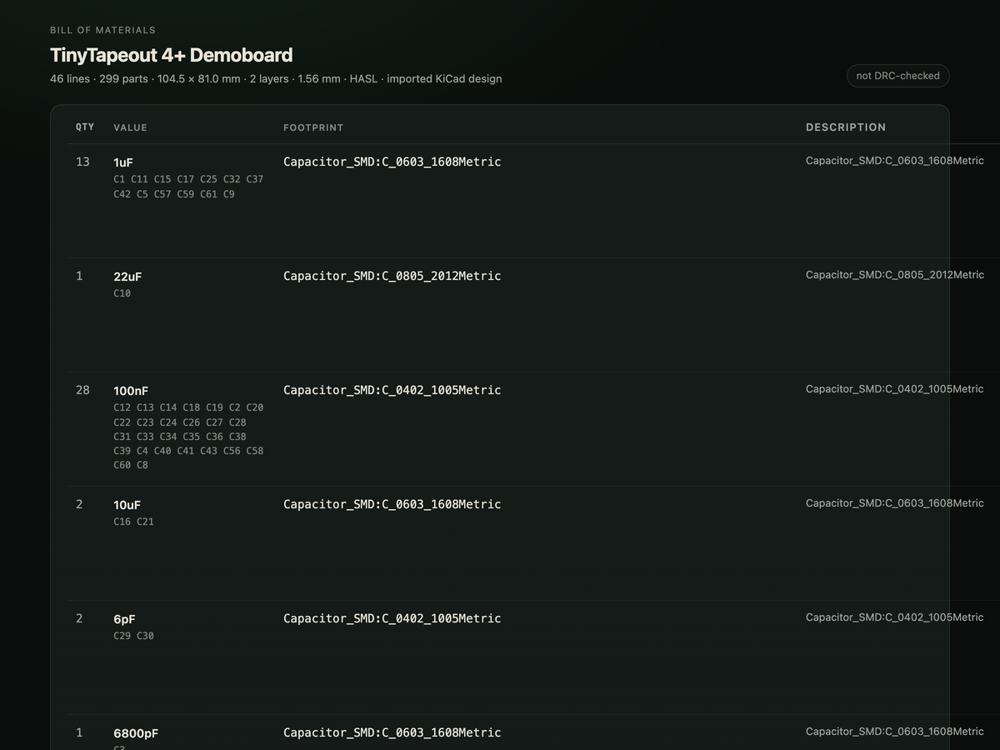
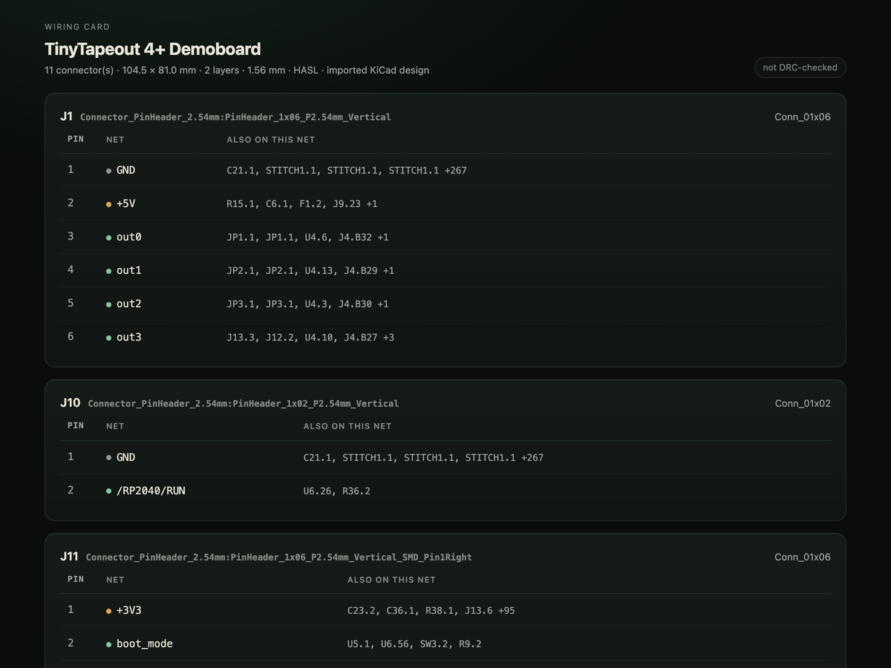
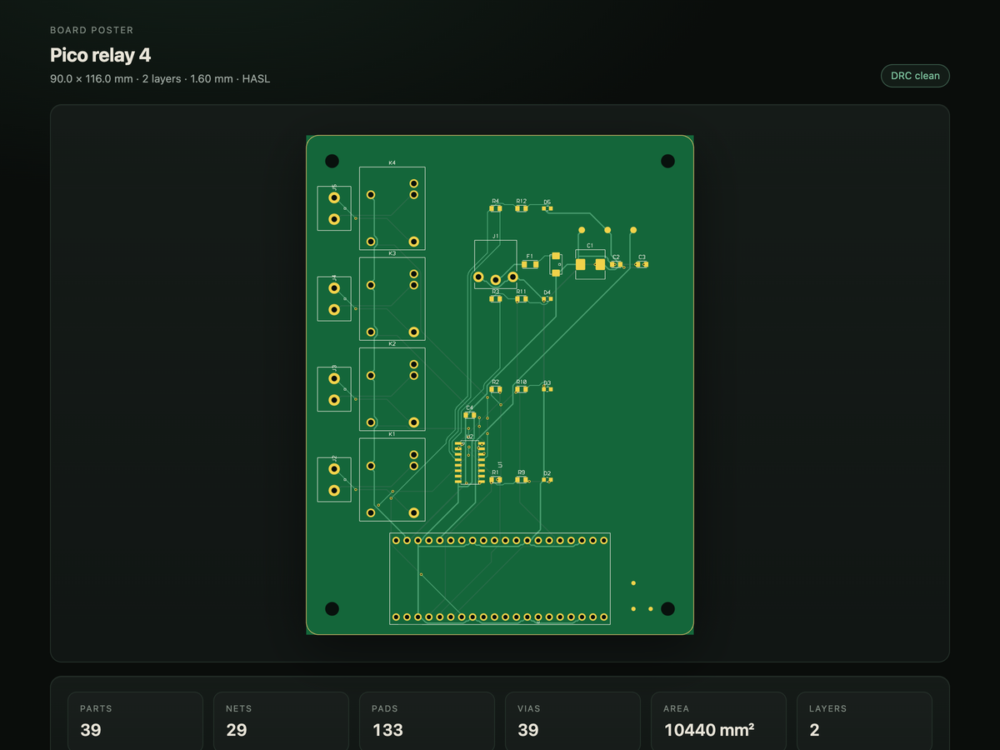
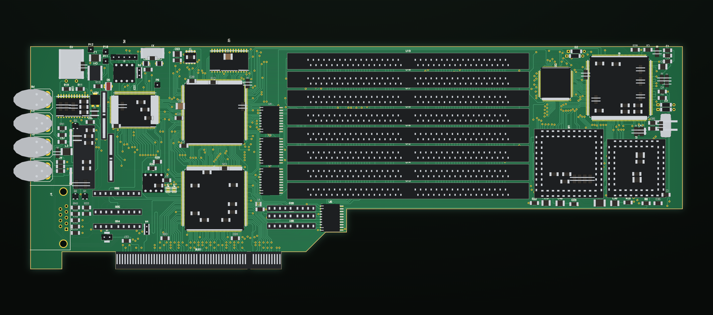
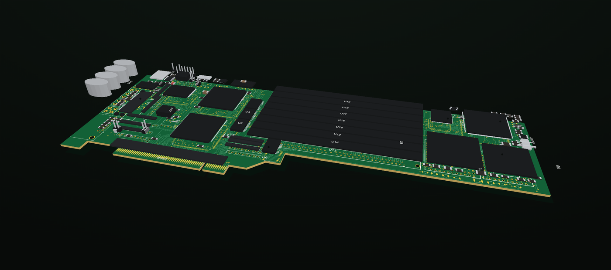

# Circuit

**Design a real PCB by talking to your agent.**

Circuit is a two-layer board compiler that runs inside Hermes. You describe the
hardware in chat; the plugin holds the part library, adds and connects the parts,
places them deterministically, routes both copper layers, checks the result with
its own design-rule engine, and writes a fabrication package a board house will
accept. Then it shows you the board — 2D and 3D — and hands you the documents you
need to buy the parts and build it.



```bash
hermes plugins install circuit
```

## What you can ask for

> "Design a 4-channel relay controller for a Raspberry Pi Pico — ULN2003 drivers,
> screw terminals, a 5 V input, and mounting holes."

> "Import this KiCad board and show me the bottom copper."

> "Give me the shopping list for the board we just made."

Fifteen tools carry the work: `circuit_create`, `circuit_add_part`,
`circuit_connect`, `circuit_place`, `circuit_route`, `circuit_check`,
`circuit_export`, `circuit_docs`, `circuit_view`, and the read/import/sample
tools around them. A bundled skill teaches the agent the order to call them in.

## What comes out

`circuit_export` writes a package you can upload to a fab:

- **RS-274X Gerbers** with X2 attributes — copper, mask, silk, edge cuts, and
  tented vias
- **Excellon drills** plus the Ucamco job file that ties the set together
- **A KiCad 8 project**, so the board opens in a real EDA tool
- **A STEP AP214 model** for the mechanical fit
- **BOM with MPN columns**, and pick-and-place in both JLC and generic dialects
- **Three documents**: a shopping list with distributor search links for every
  part that has a part number, a wiring card for the connectors, and a board
  poster

| Shopping list | Wiring card | Board poster |
|---|---|---|
|  |  |  |

## The viewer

The Desktop page renders the board with a per-pixel z-buffer — solid parts, real
depth, no transparency tricks — and an exploded view that lifts every component
off the substrate. Layers toggle independently. Boards imported from KiCad render
the same way.

| 2D layer stackup | Exploded view |
|---|---|
|  |  |

## Where it puts things

Everything stays under the plugin's own data directory:

```
plugin-data/circuit/projects/<slug>/board.json     the design
plugin-data/circuit/projects/<slug>/view.json      what the viewer reads
plugin-data/circuit/projects/<slug>/exports/       Gerbers, drills, docs, zips
```

No network calls of its own, no credentials, no subprocesses, no telemetry. Two
tools fetch a file only when you ask them to: `circuit_samples` pulls an
open-source board from its upstream URL, and `circuit_import url=…` pulls one
from a URL you give it.

## Scope

Two copper layers. The netlist is the source of truth — there is no schematic
capture step to keep in sync. The router searches a grid, so a 39-part board takes
about two and a half minutes while small boards are instant; a bigger design wants
a bigger outline and a deliberate layout.

The [full README](https://github.com/odtboun/hermes-circuit#readme) covers the
engine, the export format details, the part library, the sample catalogue and how
to contribute.
